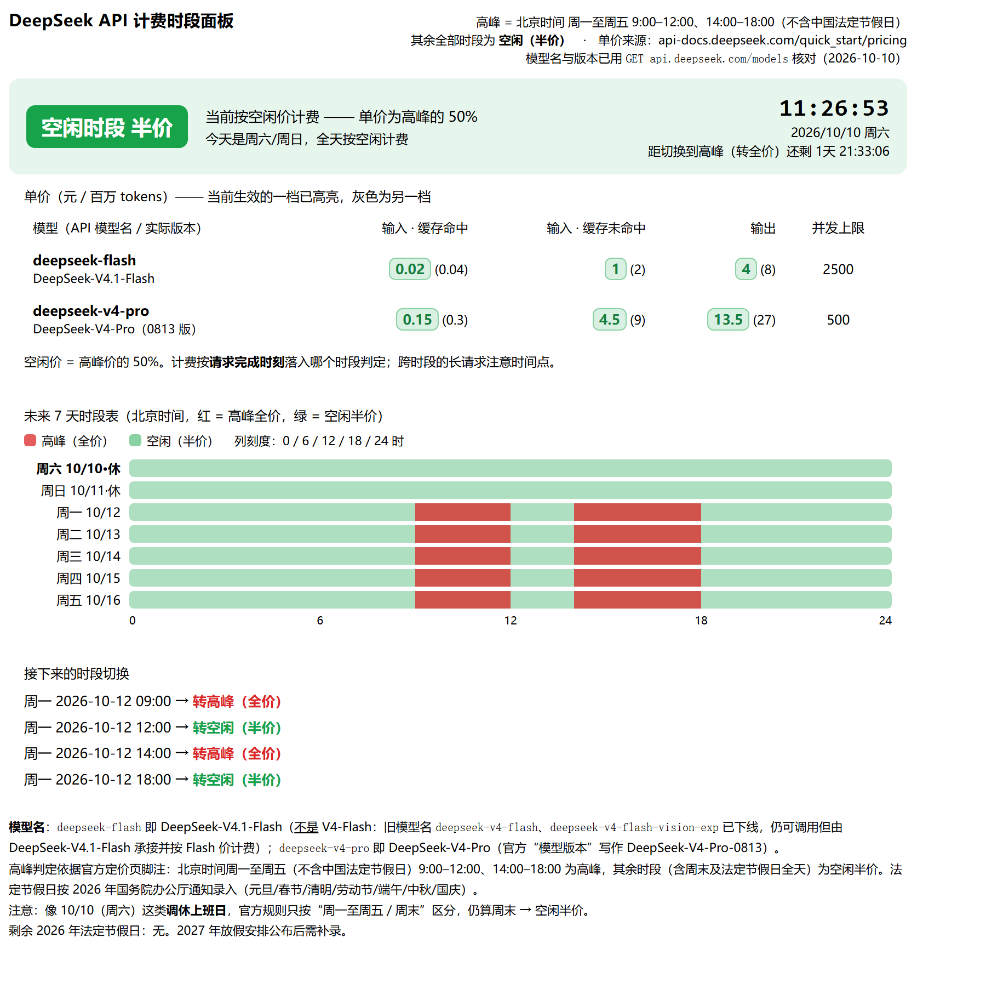

# DeepSeek API Peak / Off-Peak Pricing Panel

[简体中文](README.zh-CN.md)

One HTML file. Open it and you can see whether the DeepSeek API is billing at peak or off-peak right now, and when the tier flips next.



No build, no dependencies, no network. Double-click the file.

## The rule

> Peak = Beijing time (UTC+8) Monday–Friday 09:00–12:00 and 14:00–18:00, excluding Chinese public holidays.
> Every other instant — weekday nights, the 12:00–14:00 lunch break, all weekend, all holidays — bills at exactly 50% of the peak rate.

Same model and tokens, 2× the price between tiers. The official page does not specify how a request spanning a tier boundary is assigned; use the actual bill as the authority.

## Run it

```bash
git clone https://github.com/ybbms777/deepseek-pricing-panel
cd deepseek-pricing-panel
```

Open `index.html` in any browser. On Windows you can double-click `打开面板.bat` instead.

### Desktop app (Windows, Tauri)

`desktop/` wraps the same panel in a Tauri shell: a native window plus a tray icon (show/hide, always-on-top toggle, quit), and closing the window hides it to the tray instead of exiting. It serves the very same HTML — no logic is rewritten.

```bash
node desktop/tools/sync-panel.mjs        # copy the current panel into the shell
cd desktop && npx @tauri-apps/cli build  # → src-tauri/target/release/bundle/nsis/
```

The local Rust build checks that the embedded copy matches `index.html` and stops on drift. Run the sync command before building. This also protects direct Cargo builds; CI has a separate drift check.

Run the tests (Node 20+, no third-party packages):

```bash
node --test        # logic, CLI, installation and render regressions
```

## What the page shows

It uses three panes in a viewport-height grid with dark/light toggle and keyboard control.
Below 1180px, scroll horizontally to reach all panes. Arrow keys in inputs keep their native behavior.

| Pane | What |
|---|---|
| Top bar | Live tier, Beijing clock, countdown to the next switch, copy-summary button |
| Left | Current window progress, the next 4 switches, 7-day totals, and a cost calculator (type input/output tokens → what it costs now vs. moved entirely off-peak) |
| Middle | 14-day timetable (one 24-hour lane per day, peak as a solid block, "now" rule on today) plus a bar chart of peak hours per day |
| Right | Selected day detail, an hourly price-multiplier bar chart, and the price table |
| Bottom | The rule and where the numbers come from |

`↑`/`↓` pick a day, `T` jumps to today, `D` toggles dark mode; clicking a row in the timetable shows that day on the right.

## Where the numbers come from

- Schedule rule and prices: [official pricing page](https://api-docs.deepseek.com/zh-cn/quick_start/pricing/), checked 2026-10-15
- Model ids and versions: a live `GET https://api.deepseek.com/models`
- Holidays: State Council notice for 2026, 33 days
- Logic: `node --test` covers boundaries, holidays, next switches, half-price rates, CLI validation, rolling windows, installation from an unrelated directory, calendar coverage, and fixed-clock rendering. Existing CI uses Ubuntu and Windows with Node 20 and 22; local checks do not require CI.

## Model names

The API model name is not the model version:

| API model name | Actual model | Notes |
|---|---|---|
| `deepseek-flash` | DeepSeek-V4.1-Flash | 1M context, up to 384K output, accepts images |
| `deepseek-v4-pro` | DeepSeek-V4-Pro | 1M context, up to 384K output, text only |

`deepseek-flash` is not V4-Flash. The legacy ids `deepseek-v4-flash` and `deepseek-v4-flash-vision-exp` still resolve, but those models are retired: requests are served by DeepSeek-V4.1-Flash at Flash prices.

## Prices (RMB per 1M tokens)

| Model | Input · cache hit | Input · cache miss | Output | Concurrency |
|---|---|---|---|---|
| `deepseek-flash` off-peak | 0.02 | 1 | 4 | 2500 |
| `deepseek-flash` peak | 0.04 | 2 | 8 | 2500 |
| `deepseek-v4-pro` off-peak | 0.15 | 4.5 | 13.5 | 500 |
| `deepseek-v4-pro` peak | 0.30 | 9.0 | 27.0 | 500 |

Transcribed from the official pricing page, which can change. Treat the panel as a view of the published rule, not as the rule itself.

## From Hermes Agent or a script

The repo ships a Hermes skill at `skills/deepseek-pricing-tier/`. Its CLI evaluates the `/*CORE-START*/ … /*CORE-END*/` block pulled out of `index.html`, so there is no second copy of the logic:

```bash
node skills/deepseek-pricing-tier/scripts/deepseek_tier.mjs            # now
node skills/deepseek-pricing-tier/scripts/deepseek_tier.mjs --json     # for an agent
node skills/deepseek-pricing-tier/scripts/deepseek_tier.mjs --days 7   # upcoming switches
```

Exit code 0 = off-peak, 3 = peak, 2 = error or incomplete holiday coverage. `node deepseek_tier.mjs --quiet && run_your_batch` runs the batch only if this check returns 0; it skips it during peak time. It does not wait, retry or schedule a later run. Warnings still go to stderr with `--quiet`.

`--days N` accepts integers 0–366 and lists switches in the rolling interval `[at, at + N×24h)`: a switch exactly at the start is included, the end is excluded. Zero omits the list. `--at` requires an ISO date-time with seconds and an explicit `Z` or UTC offset. The webpage's 7-day summary instead covers seven Beijing calendar days starting at today's midnight.

Install the skill **with its HTML dependency** into a new destination (the installer refuses to overwrite an existing directory):

```bash
node tools/install-skill.mjs /path/to/hermes/skills/deepseek-pricing-tier
```

You can invoke the installer by its absolute path from any working directory. The installed `scripts/deepseek_tier.mjs` then runs from any working directory too. Alternatively, copy the skill directory and the repository's `index.html` into the skill directory, or explicitly set `--panel` / `DEEPSEEK_PANEL_HTML` to the repository HTML. A missing explicitly configured path is an error, with no silent fallback.

JSON includes `data_metadata`, `current_calendar_covered`, `calendar_coverage` and `warnings`. Coverage includes all dates consulted for the next switch and the requested future window; a cross-year gap also exits 2. Unmaintained dates remain estimates based on the weekly rule, not confirmed holiday-aware results. The page warns for gaps anywhere in its 14-day timetable, including future years.

## Change it

Everything adjustable lives in the `/*CORE-START*/ … /*CORE-END*/` block of `index.html`:

```js
HOLIDAYS          // Set of 'YYYY-MM-DD' public holidays
PRICES            // model -> version name, [off-peak, peak] rates, concurrency
isPeakHour(y,mo,d,h)
tierAt(ts)        // 'off' | 'peak'
nextSwitch(ts)    // timestamp of the next tier change
daySegments(ts)   // peak ranges of a given Beijing-time day
```

When next year's holiday notice is published, verify and append the dates to `HOLIDAYS`, then update `DATA_METADATA.holiday_years` and its source. Recheck prices before updating `pricing_checked_on`.

## Two caveats

- A make-up workday on a Saturday counts as off-peak. The rule only distinguishes Monday–Friday from weekend, so 2026-10-10 (a Saturday the government turned into a workday) reads as off-peak at half price. If an invoice disagrees, the invoice wins.
- 2027 holidays are not included. 2026 is built in; add the 2027 dates when the notice is published.

## License

MIT, see [LICENSE](LICENSE).
